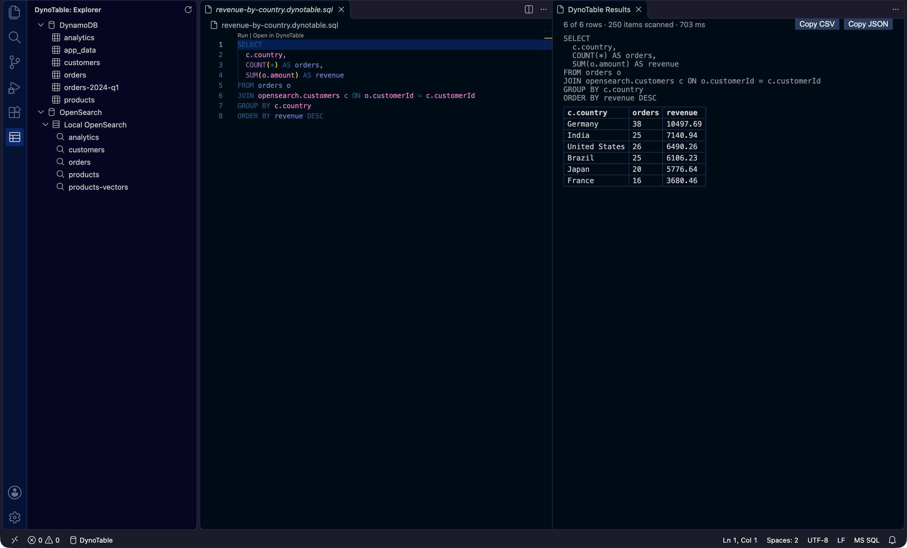

# DynoTable for VS Code

Write SQL, PartiQL and OpenSearch queries in VS Code. The [DynoTable](https://dynotable.com)
desktop app serves the language features and runs the queries.



- Completion from your real table schemas and index mappings.
- Diagnostics with quick fixes, hover, the query plan above each statement, formatting, and
  rename of table aliases.
- **Run** a statement. The rows show in a results panel.
- An explorer of the tables and indices of your DynoTable profile.
- **Open in DynoTable** opens the app at the statement's table or index.

Full guide: [dynotable.com/docs/editors](https://dynotable.com/docs/editors).

This repository also holds [`dynotable-cli`](#command-line-dynotable-cli), a command line tool for AI
agents, the [Claude Code plugin](#claude-code-plugin), and the
[`dynotable-lsp`](#other-editors-dynotable-lsp) bridge for Neovim and other editors.

## Examples

A SQL JOIN, in `orders.dynotable.sql`:

```sql
SELECT o.orderId, o.status, c.country FROM "orders" o JOIN "customers" c ON o.customerId = c.customerId
```

A DynamoDB PartiQL query, in `orders.partiql`:

```sql
SELECT * FROM "orders" WHERE customerId = 'CUST010'
```

An OpenSearch query DSL search, in `orders.opensearch`. The first line names the index:

```
// dynotable: index=orders
{"query": {"match": {"status": "shipped"}}}
```

## Requirements

- The DynoTable desktop app, version 1.19.0 or later, installed on the same computer.
- The Editor integration switched on in the app. **It is off by default.**
- VS Code 1.91 or later, in a trusted workspace.

### Switch on the Editor integration

1. Open DynoTable.
2. Go to **Settings → Editor integration**.
3. Switch on **Editor integration**.

You do this one time. After that, the extension starts DynoTable when it needs the app.

## Query files

| File              | Language                                 |
| ----------------- | ---------------------------------------- |
| `*.dtsql`         | DynoTable SQL (tables and indices)       |
| `*.dynotable.sql` | DynoTable SQL (tables and indices)       |
| `*.partiql`       | DynamoDB PartiQL                         |
| `*.opensearch`    | One OpenSearch query: JSON DSL or Lucene |

A `*.dtsql` file always attaches. **DynoTable: New Query** creates one. DynoTable does not attach
to other `.sql` files. To attach one, open it and run **DynoTable: Attach SQL File**. The command
adds the file to the `dynotable.sqlFiles` setting of its workspace folder. Each folder's own
`dynotable.sqlFiles` decides which of its `.sql` files attach. In a window with no folder, name the
file `*.dtsql` or `*.dynotable.sql`. In a window with folders, a `.sql` file outside them does not
attach.

An OpenSearch query names its index on its first line:

```
// dynotable: index=orders
{"query": {"match": {"status": "shipped"}}}
```

When two OpenSearch targets have an index with the same name, add `target=<target name>`. Also add
it when DynoTable could not list the indices of all targets. **Pick Index** and the explorer's New
Query do this for you. A target name that contains a space cannot be written there.

## Use it

- **New query.** Run **DynoTable: New Query** and choose SQL, PartiQL or OpenSearch. In the
  explorer, click a table or an index, or its New Query button, to open a query for it.
- **Run.** Click the **Run** lens above a statement, press Cmd+Enter (Ctrl+Enter on Windows and
  Linux), or run **DynoTable: Run**. Run uses the
  selection. With no selection, it uses the statement at the cursor, or else the whole file. An
  OpenSearch query runs the selection or the whole file.
- **Results.** One panel shows the rows of the last run in a grid. It shows the total only when
  DynoTable knows it. A run returns up to 500 rows. Click a header to sort. **Find** (Cmd+F or
  Ctrl+F) highlights the cells that match, and **Filter rows** hides the other rows. The filter icon
  in a header filters the column by its values. Click, Shift-click or Cmd-click (Ctrl-click) to
  select cells. Cmd+C (Ctrl+C) copies them as tab-separated text. Right-click a cell to copy the
  selection as CSV, JSON or Markdown, or to open **Record View**. Right-click a header to sort, pin
  or hide its column. Double-click a cell to see its full value. The line under the grid shows the
  count, sum, average, minimum and maximum of the selected cells. **Copy CSV**, **Copy JSON** and
  **Export…** copy or save all rows. **Cancel** stops the run. Closing the panel also stops it. You
  can run one statement at a time.
- **Open in DynoTable.** Click the **Open in DynoTable** lens, or press Cmd+Shift+Enter
  (Ctrl+Shift+Enter) with the cursor in the statement. SQL and PartiQL only.
- **Explorer.** The DynoTable icon in the activity bar opens it. It shows your DynamoDB tables and,
  for each OpenSearch target, its indices. **Refresh** reads the lists again.
- **Pick index.** In an OpenSearch query, run **DynoTable: Pick Index** to write the index line.
- **Validate against the index.** In an OpenSearch JSON query, this code action asks the index if
  the query is valid. Nothing runs.
- **PartiQL writes** do not run from the editor. **Stage in DynoTable** opens the statement's table
  in the app. The statement stays in the editor.
- **Open Documentation.** Run **DynoTable: Open Documentation** to open the full guide.

## Profiles

A connection uses one DynoTable profile.

- When DynoTable has one profile, the extension uses it.
- When it has more, run **DynoTable: Select Profile**. While no profile is selected, a click on the
  status bar also offers it. VS Code keeps your choice for this workspace.

The status bar shows the profile you selected. Click the status bar to see what to do when
DynoTable is not connected. **DynoTable: Reconnect** connects again.

## DynoTable runs in the background

When DynoTable is not running, the extension starts it with no window. The app then keeps running
after you close VS Code, and the next VS Code window uses it again.

- **Get a window back:** open DynoTable as usual (Dock, Start menu or app launcher), or click
  **Open DynoTable** in a DynoTable message.
- Some actions need an app window: signing in to DynoTable, an expired AWS sign-in, and **Open in
  DynoTable** on a profile with no open window.
- **macOS:** a permission prompt from DynoTable can name Visual Studio Code. This is because VS Code
  started the app.
- **Linux:** the extension cannot read the app version before it starts the app. An app that is too
  old opens a window one time. An AppImage install needs `dynotable.appPath`.
- If you updated DynoTable but did not restart it, the old app can open a window one time. Restart
  DynoTable.

## Free and paid

The extension is free. What runs depends on your DynoTable licence, as in the app:

- **Free (signed in):** completion, diagnostics, PartiQL `SELECT`, and OpenSearch queries.
- **Trial or paid:** running SQL statements, as in the SQL Workbench. This includes SQL that
  reads an OpenSearch index and a JOIN across DynamoDB and OpenSearch.
- **Signed out:** nothing. Sign in to DynoTable.

See [Activation](https://dynotable.com/docs/activation) for the licence states.

## Settings

| Setting                 | Default                  | Description                                                                         |
| ----------------------- | ------------------------ | ----------------------------------------------------------------------------------- |
| `dynotable.sqlFiles`    | `["**/*.dynotable.sql"]` | Glob patterns of the `.sql` files that DynoTable serves.                            |
| `dynotable.appPath`     | empty                    | The path of the DynoTable app. Set it when the app is not in its standard location. |
| `dynotable.userDataDir` | empty                    | The app's user data directory. When set, the extension does not start the app.      |

## Privacy

The extension connects only to the DynoTable app on your computer (`127.0.0.1`). It reads the
connection token from the app's port file and does not store it.

## Platforms

Tested on macOS. Windows and Linux are not verified yet. A Flatpak install of VS Code is not
supported.

Remote workspaces (SSH, WSL, Dev Containers) are not supported. DynoTable serves only files on this
computer and new untitled queries.

## Command line: dynotable-cli

`dynotable-cli` reads DynamoDB and OpenSearch through the DynoTable app. It is for AI agents, such
as Claude Code, Codex and Cursor, and for scripts. It only reads, and its output is JSON.

### Requirements

- The DynoTable desktop app, version 1.20.0 or later, on the same computer.
- The Editor integration switched on in the app (see
  [Switch on the Editor integration](#switch-on-the-editor-integration)).
- One or more profiles **available to agents**. In DynoTable, switch on **Available to agents** for
  each profile that agents can read. `dynotable-cli` cannot see the other profiles.

An app older than 1.20.0 ignores agent sessions. `dynotable-cli` refuses it with `update-app`, but
only after the app answered `initialize`, so that app has already signed in to the named profile.
No data reaches the agent.

### Install

- **npm:** `npm install -g dynotable-cli`. This also installs `dynotable-lsp`.
- **GitHub Releases:** download `dynotable-cli-<version>-<os>-<arch>.tar.gz` from
  [Releases](https://github.com/dynotable/vscode-dynotable/releases). Extract it with
  `tar -xzf <file>`, and put `dynotable-cli` and `dynotable-lsp` on your `PATH`.
- **Windows:** use the Releases archive and put the folder that holds `dynotable-cli.exe` on your
  `PATH`. The Claude Code plugin cannot start the command that npm installs on Windows.

Binaries are available for macOS on Apple silicon, Linux x64 and Windows x64. The macOS binary is
tested on each build, and the Linux x64 binary was run in a container. The Windows binary has not
been run yet.

### Commands

```sh
dynotable-cli profiles                  # the profiles available to agents
dynotable-cli tables --profile dev      # the DynamoDB tables of a profile
dynotable-cli indices --profile dev     # the OpenSearch indices of a profile
dynotable-cli run orders.dtsql          # run the statement in a file
dynotable-cli run -e "SELECT * FROM \"orders\" WHERE customerId = 'C1'" --lang partiql
printf '// dynotable: index=orders\n{"query": {"match_all": {}}}' | dynotable-cli run - --lang opensearch
dynotable-cli lsp --no-launch           # the stdio language server bridge for Claude Code
```

- `run` reads one input: a file, stdin (`-`), or the text after `-e`. Give **one statement per
  input**.
- A file must end in `.dtsql`, `.dynotable.sql`, `.partiql` or `.opensearch`. The file name gives
  the language. The CLI refuses all other files.
- Stdin and `-e` need `--lang sql`, `--lang partiql` or `--lang opensearch`.
- `--row-cap <n>` sets the most rows that `run` returns. The default is 500, and the maximum is 1000. `truncated: true` in the result means that more rows exist.
- Writes do not run. A PartiQL write fails with `stage-in-app`. Stage writes in DynoTable.
- `dynotable-cli --help` shows all options.

When DynoTable is not running, `dynotable-cli` starts it with no window. The app keeps running
after the command ends. `--no-launch` stops this: the command then fails with `launcher-off`.

### Profiles and `.dynotable.json`

A command uses the first profile it finds:

1. `--profile <id or slug>`.
2. The `profile` key of `.dynotable.json` in the current directory.
3. The only profile available to agents, when there is exactly one.

```json
{"profile": "dev"}
```

`dynotable-cli` reads only the `profile` key. A `.dynotable.json` that is not valid fails with
`usage`. A profile that is not found and a profile that is not
available to agents both fail with `profile-not-exposed`.

### Output and exit codes

Stdout holds one JSON document: DynoTable's answer to the request, as the protocol defines it
(see [PROTOCOL.md](PROTOCOL.md)). `profiles` prints the array of `dynotable/listProfiles`, `tables`
and `indices` print the answer of `dynotable/listTables` and `dynotable/listIndices`, and `run`
prints the result of `dynotable.runStatement`. On failure, stderr holds one JSON line:

```json
{
  "code": "profile-not-exposed",
  "message": "The profile is not found, or it is not available to agents. Make the profile available to agents in DynoTable."
}
```

`detail`, when present, gives more data, such as the text that DynoTable sent.

| Exit code | Meaning                                            |
| --------- | -------------------------------------------------- |
| `0`       | Success.                                           |
| `1`       | Failure. Read `code` on stderr.                    |
| `2`       | The command line is not valid (`code` is `usage`). |
| `130`     | Interrupted with Ctrl+C. Stdout is empty.          |

| `code`                            | What to do                                                    |
| --------------------------------- | ------------------------------------------------------------- |
| `profile-not-exposed`             | Make the profile available to agents in DynoTable.            |
| `profile-required`                | Give `--profile`. `dynotable-cli profiles` lists the choices. |
| `stage-in-app`                    | The CLI only reads. Make writes in DynoTable.                 |
| `reauth-required`, `signed-out`   | Open DynoTable and sign in.                                   |
| `launcher-off`, `integration-off` | Start DynoTable, or switch on the Editor integration.         |
| `agent-refused`                   | The request is not available to agents. Do it in DynoTable.   |
| `update-app`                      | Update DynoTable.                                             |
| `listing-failed`                  | The listing is not complete. Stdout holds the rows it read.   |

Every other `code` comes with a `message` that tells what to do.

### Audit log

Each `tables`, `indices` and `run` request writes a row in the audit log of the profile in
DynoTable. The row holds the statement, not the rows that it returned. When DynoTable cannot write
the row, the request fails and returns no data. `profiles` writes no row.

`dynotable-cli lsp` writes rows only for the same requests. Its completion, diagnostics and code
actions write none: they give table, index and field names, never stored values.

### Environment variables

| Variable                  | Use                                                                         |
| ------------------------- | --------------------------------------------------------------------------- |
| `DYNOTABLE_APP_PATH`      | The path of the DynoTable app, when it is not in its standard location.     |
| `DYNOTABLE_USER_DATA_DIR` | The app's user data directory. When set, `dynotable-cli` does not start it. |

### Claude Code permissions

`dynotable-cli` always opens an agent session: every command, `dynotable-cli lsp` included. An
agent that can run only `dynotable-cli` can read only the profiles available to agents. A process
that can run any command as you can also read DynoTable's files, so do not give an agent more than
`dynotable-cli`. Add this rule to your Claude Code settings:

```json
{
  "permissions": {
    "allow": ["Bash(dynotable-cli:*)"],
    "deny": [
      "Bash(dynotable-lsp:*)",
      "Read(~/Library/Application Support/DynoTable/**)",
      "Read(~/.config/DynoTable/**)",
      "Read(~/AppData/Roaming/DynoTable/**)"
    ]
  }
}
```

The three `Read` paths are the DynoTable user data directories on macOS, Linux and Windows. Keep the
one for your platform.

## Claude Code plugin

The plugin gives Claude Code a `dynotable` skill that uses `dynotable-cli`. It also gives
diagnostics and hover in `.dtsql`, `.partiql` and `.opensearch` files. It does not map `.sql` files.

1. Install `dynotable-cli` (see [Install](#install)).
2. In Claude Code, add the marketplace and install the plugin:

   ```
   /plugin marketplace add dynotable/claude-plugins
   /plugin install dynotable@dynotable
   ```

   From a shell: `claude plugin marketplace add dynotable/claude-plugins`, then
   `claude plugin install dynotable@dynotable`.

The plugin's language server does not start DynoTable. When DynoTable is not running, the server
waits up to 20 s for the app, and then stops. When you quit DynoTable, the server stops. It does not
start the app again with no window.

**Known limitation (unverified).** Claude Code restarts a stopped server at most twice in a session
(`maxRestarts: 2`). Each quit or update of DynoTable, and each 20 s wait that ends with no app, can
use one restart. When DynoTable stays closed for more than about 40 s, the plugin's diagnostics may
stop for the rest of the Claude Code session. Start a new Claude Code session to get them back.

## Other editors: dynotable-lsp

`dynotable-lsp` connects an editor that speaks the Language Server Protocol over stdio to DynoTable.
It needs DynoTable 1.20.0 or later, with the Editor integration switched on.
It is the same program as `dynotable-cli`, under a second name. It opens an editor session: it can
use every profile, and it does not write audit rows. It starts DynoTable with no window when the app
is not running. Use it only in an editor, not in an agent.

- It takes `--profile <id or slug>` and `--no-launch`.
- With no `--profile`, it uses the `profile` of the editor's `initializationOptions`, then
  `.dynotable.json` in the workspace root.
- The editor must send the language ids `sql`, `partiql` and `opensearch`.

Neovim 0.10 or later:

```lua
vim.filetype.add({
  extension = { dtsql = 'sql', partiql = 'partiql', opensearch = 'opensearch' },
})

vim.api.nvim_create_autocmd('FileType', {
  pattern = { 'sql', 'partiql', 'opensearch' },
  callback = function(args)
    local name = vim.api.nvim_buf_get_name(args.buf)
    -- Serve only DynoTable's own SQL files, not every .sql file.
    if vim.bo[args.buf].filetype == 'sql'
      and not (name:match('%.dtsql$') or name:match('%.dynotable%.sql$')) then
      return
    end
    vim.lsp.start({
      name = 'dynotable',
      cmd = { 'dynotable-lsp' },
      root_dir = vim.fs.root(args.buf, { '.dynotable.json', '.git' }),
    }, { bufnr = args.buf })
  end,
})
```

## For client authors

[PROTOCOL.md](PROTOCOL.md) describes the wire protocol of the DynoTable language server.
[CONTRIBUTING.md](CONTRIBUTING.md) tells how to build and test this extension.

## License

[MIT](LICENSE)
